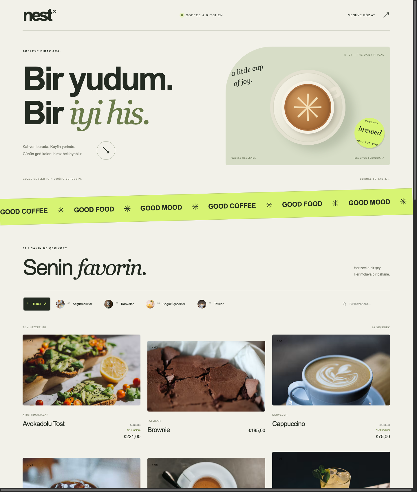
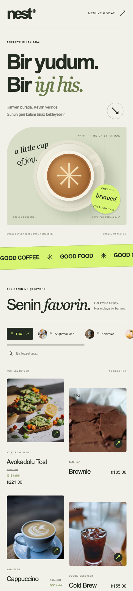
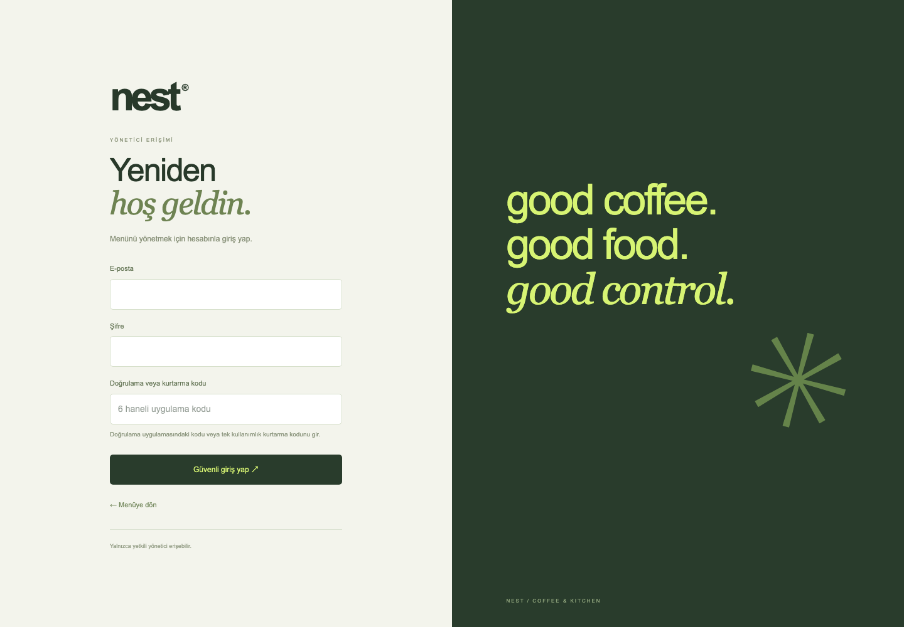

# Nest QR Menu

Tek bir işletme için geliştirilen, mobil uyumlu dijital menü ve yönetim paneli. Müşteriler menüyü tarayıcıdan inceler; işletme sahibi kategorileri, ürünleri, fiyatları ve indirimleri CMS üzerinden yönetir.

**Next.js · NestJS · TypeScript · Drizzle ORM · Neon PostgreSQL**



## Özellikler

- Kategoriye göre filtreleme, ürün arama ve ürün detay penceresi.
- Türk lirası fiyat gösterimi ve yüzdelik indirimler.
- Mobil uyumlu kartlar, açılış animasyonu ve yükleme skeleton'ları.
- Sunucuda `no-store` ile alınan güncel kategori ve ürün verileri.
- Admin panelinden kategori ve ürün oluşturma, düzenleme ve silme; ürün eklerken kategori seçimi.
- E-posta, şifre ve TOTP ile iki aşamalı yönetici girişi; tek kullanımlık kurtarma kodları.
- Veritabanında tutulan oturumlar, HttpOnly cookie, giriş denemesi sınırı ve tüm cihazlardan çıkış.

Proje şu aşamada tek işletme içindir. Müşteri üyeliği, çoklu işletme, sipariş ve ödeme akışı bulunmaz. QR kodunuzun hedefi yayımladığınız menünün URL'si olmalıdır; uygulama içinde QR kod üreticisi yoktur.

## Ekran görüntüleri

Yerel uygulamadan alınmış masaüstü, mobil genişlik ve yönetici giriş ekranlarıdır. Ürün ve kategoriler bağlı veritabanındaki içeriğe göre değişir.

| Mobil menü | Yönetici girişi |
| --- | --- |
|  |  |

## Proje yapısı

```text
apps/
  api/       NestJS REST API, Drizzle şeması, migration'lar ve auth
  web/       Next.js App Router, müşteri menüsü ve admin CMS
docs/
  images/    README ekran görüntüleri
  ADMIN-SECURITY.md
```

- [Backend kurulumu ve endpoint'ler](apps/api/README.md)
- [Frontend kurulumu ve sayfalar](apps/web/README.md)
- [Menü bileşenleri](apps/web/src/components/menu/README.md)
- [Yönetici kurulumu ve hesap kurtarma](docs/ADMIN-SECURITY.md)

## Yerel kurulum

Node.js ve npm ile bir Neon PostgreSQL veritabanı gerekir. Kurulumlar `apps/api` ve `apps/web` içinde ayrı yapılır; kök dizinde ortak geliştirme komutu yoktur. Node sürümünü seçerken kilit dosyalarındaki paketlerin `engines` gereksinimlerini karşılayın.

### 1. Backend ve veritabanı

```bash
git clone https://github.com/seyitbugraerden/Nest-qrmenu.git
cd Nest-qrmenu/apps/api
npm ci
cp .env.example .env
```

`.env` içindeki `DATABASE_URL` alanına Neon bağlantı adresinizi yazın. Varsayılan API portu `3001`.

```bash
npm run auth:prepare
npm run db:migrate
npm run admin:create
npm run start:dev
```

`auth:prepare` yerel şifreleme anahtarını üretir. `admin:create` etkileşimli olarak e-posta, şifre ve doğrulama uygulaması kurulumu ister. QR kodunu bir TOTP uygulamasına ekleyin; verilen kurtarma kodlarını saklayın. Hazır kullanıcı veya varsayılan şifre yoktur. Yeni veritabanında menü boş başlar; CMS üzerinden kategori ve ürün ekleyin.

### 2. Frontend

Ayrı terminalde, depo kökünden:

```bash
cd apps/web
npm ci
cp .env.example .env.local
npm run dev
```

| Adres | Kullanım |
| --- | --- |
| `http://localhost:3000` | Müşteri menüsü |
| `http://localhost:3000/admin/login` | Yönetici girişi |
| `http://localhost:3000/admin` | Kategori ve ürün yönetimi |
| `http://localhost:3001/categories` | Herkese açık kategori API'si |

`API_URL` yalnızca Next.js sunucusunda kullanılır. Backend ve frontend terminal süreçleri birlikte açık kalmalıdır. Ortam değişkenlerini değiştirdikten sonra ilgili sunucuyu yeniden başlatın.

## Kontroller

```bash
# apps/api
npm test
npm run test:e2e
npm run build

# apps/web
npm run test:security
npm run lint
npm run build
```

Auth testleri şifre/MFA, oturum ve yetkisiz erişim kontrollerini; frontend güvenlik testleri cookie, Origin ve Server Action yetki kontrollerini kapsar. HTTP testleri mock servislerle çalışır; gerçek Neon bağlantısı için entegrasyon testi değildir.

## Dağıtım

API ve web ayrı Node.js süreçleri olarak derlenir ve çalışır. API'de `npm run build` ardından `npm run start:prod`; web'de `npm run build` ardından `npm start` kullanın. Web için `API_URL` erişilebilir backend adresi, `APP_ORIGIN` ise kullanıcının gördüğü HTTPS origin olmalıdır. Üretimde HTTPS gereklidir.

`DATABASE_URL`, `AUTH_ENCRYPTION_KEY`, yönetici QR anahtarı ve kurtarma kodları gizlidir. `.env` dosyaları Git'e dahil edilmez. Mevcut veritabanını taşırken aynı `AUTH_ENCRYPTION_KEY` korunmalıdır. Ayrıntılar için [yönetici erişimi belgesine](docs/ADMIN-SECURITY.md) bakın.
